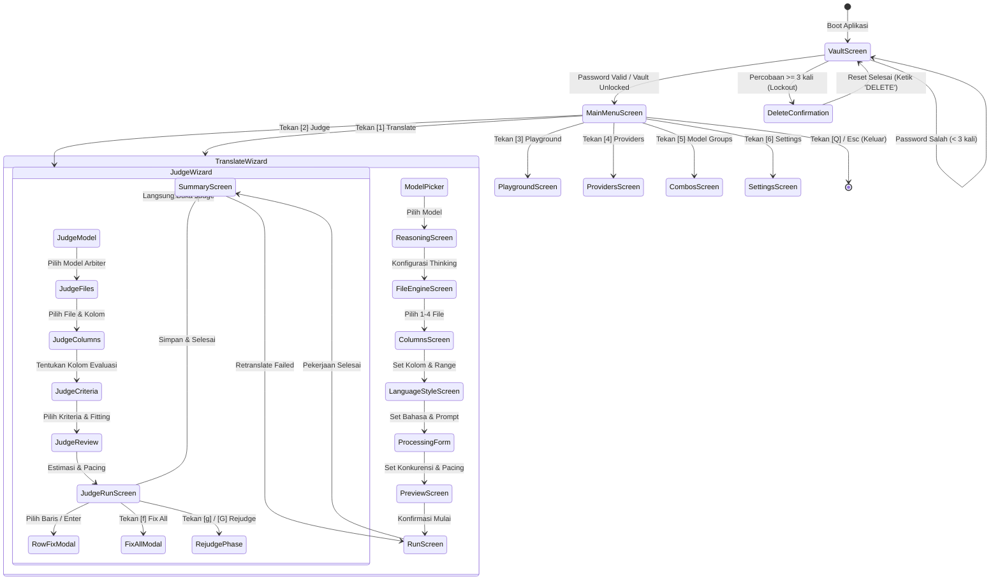
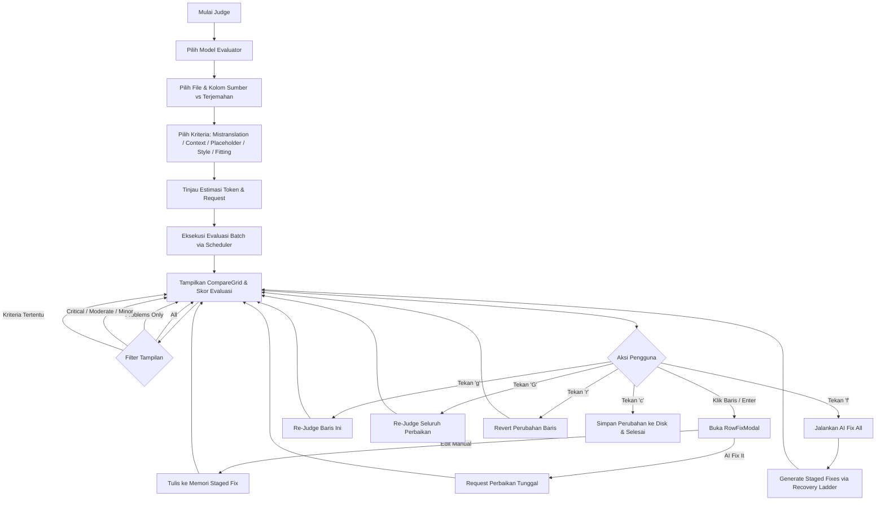

# UET-V4 User Flow & State Transitions Specification

## 1. Application Navigation & State Machine

Antarmuka pengguna UET-V4 dibangun di atas framework Textual menggunakan arsitektur **Push/Pop Screen Stack**. Navigasi dirancang berorientasi keyboard (*keyboard-first*) dengan paritas penuh terhadap interaksi mouse:



### Aturan Navigasi & Siklus Hidup Layar (`BaseScreen`)
- **Navigasi Mundur Konsisten:** Menekan `Esc` atau tombol panah kiri (`Left`) pada screen mana pun memicu `app.pop_screen()`. Data yang telah dimasukkan pengguna pada screen sebelumnya tetap dipertahankan di memori (*state retention*).
- **Go Home:** Menekan shortcut khusus atau aksi menu utama memanggil `app.go_home()`, yang secara aman melakukan pop seluruh tumpukan screen hingga kembali ke `MainMenuScreen`.
- **Global Shutdown Hook:** Kombinasi tombol `Ctrl+C` diprioritaskan di tingkat aplikasi untuk memicu `on_shutdown_hook`, menghentikan thread writer dan koneksi jaringan yang sedang aktif, lalu keluar dengan aman.
- **Rute Terlindungi (*Route Guards*):** Pada menu utama:
  - Menu *Translate*, *Judge*, dan *Playground* otomatis dinonaktifkan jika belum ada provider atau koneksi yang terdaftar.
  - Menu *Model Groups* dinonaktifkan jika belum ada model terkonfigurasi.

---

## 2. Vault Screen & Authentication Flow

Layar pertama saat aplikasi dibuka adalah `VaultScreen`:

1. **Inisialisasi Pertama (First-Run Setup):**
   - Jika berkas `vault.enc` belum ditemukan:
   - Pengguna diminta memasukkan kata sandi baru dan mengulanginya untuk konfirmasi.
   - Kata sandi digunakan untuk menurunkan kunci enkripsi awal dan membuat berkas brankas kosong yang valid.
2. **Sesi Berkelanjutan (Unlock Sesi):**
   - Jika `vault.enc` sudah ada:
   - Pengguna diminta memasukkan kata sandi brankas.
   - Sistem memverifikasi tag HMAC-SHA256 dari berkas.
3. **Penanganan Percobaan Gagal & Brute-Force Lockout:**
   - Sistem melacak jumlah kegagalan berturut-turut.
   - Jika pengguna salah memasukkan kata sandi sebanyak 3 kali (`VAULT_MAX_ATTEMPTS`), brankas dikunci.
   - Satu-satunya cara membuka kunci adalah melakukan reset brankas secara destruktif dengan mengetikkan kata `DELETE` secara eksplisit, menghapus file `vault.enc` yang rusak/lupa kata sandi, dan memulai pembuatan brankas baru.

---

## 3. Translate Wizard User Flow (Step-by-Step)

Wizard penerjemahan dirancang memandu pengguna melewati konfigurasi bertahap sebelum pekerjaan dieksekusi:

### Langkah 1: Pemilihan Model (`ModelPicker`)
- Menggunakan widget kaskade: `Provider -> Connection -> Model`.
- Menampilkan status koneksi, latensi pengujian terakhir, dan preset batas kuota.
- Pengguna dapat memilih model tunggal, model combo (*Model Group*), atau mode rotasi otomatis provider (*automatic pooling*).
- Validasi instan: tombol lanjut hanya aktif jika pilihan berstatus *runnable*.

### Langkah 2: Konfigurasi Reasoning / Thinking (`ReasoningScreen`)
- Layar ini muncul secara dinamis berdasarkan metadata model yang dipilih:
  - **Model Toggleable:** Menampilkan switch ON/OFF untuk fitur penalaran.
  - **Model Effort-based:** Menampilkan pilihan tingkat effort (`low`, `medium`, `high`).
  - **Model Always-On / Unsupported:** Layar ini dilewati secara otomatis tanpa memerlukan input tambahan dari pengguna.
  - **Model Groups:** Dilewati otomatis karena setiap anggota grup membawa konfigurasi reasoning independen masing-masing.

### Langkah 3: Pemilihan File (`FileEngineScreen`)
- Memindai direktori kerja aktif dan menampilkan daftar berkas spreadsheet (XLSX, CSV).
- Mendukung pemilihan multi-file (hingga 4 file sekaligus) menggunakan tombol `Space`.
- Menerima masukan path absolut atau relatif manual, serta daftar berkas yang dipisahkan oleh tanda koma atau titik-koma.
- Secara otomatis mengabaikan berkas di dalam folder `.uet_cache` dan berkas temporer Excel (`~$*.xlsx`).
- Menghitung path keluaran default secara otomatis (menambahkan suffix bahasa target).

### Langkah 4: Pemilihan Kolom & Jangkauan Baris (`ColumnsScreen`)
- Menampilkan pratinjau tabel mini (*ColumnPreview*) dari 5 baris pertama spreadsheet.
- Mendeteksi header kolom secara otomatis (`detect_columns`).
- Pengguna menetapkan peran kolom:
  - **Source Column (Wajib):** Kolom teks sumber yang akan diterjemahkan.
  - **Destination Column (Wajib):** Kolom tujuan penulisan terjemahan.
  - **Context Column (Opsional):** Kolom keterangan konteks tambahan (misal: nama pembicara, ID lokasi).
  - **Repair Column (Opsional):** Kolom khusus penulisan hasil perbaikan kualitas.
- Menetapkan batasan baris: baris awal (`start_row`) dan jumlah baris (`num_rows` atau sampai akhir berkas).
- Menghitung estimasi deduplikasi teks jika opsi deduplikasi diaktifkan.

### Langkah 5: Bahasa Target & Gaya Bahasa (`LanguageStyleScreen`)
- Menentukan bahasa sumber (opsional / auto-detect) dan bahasa target (wajib).
- Memilih preset prompt sistem (misal: *RPG Game Dialogue*, *Formal Document*, *Casual Conversation*, atau *Literal*).
- Menyediakan editor prompt interaktif untuk menyesuaikan instruksi sistem khusus.
- Pengguna dapat menyimpan prompt kustom sebagai preset baru (*Save as Preset*) atau menggunakannya untuk sesi ini saja (*Use Once*).

### Langkah 6: Parameter Pemrosesan & Konkurensi (`ProcessingForm`)
- Menampilkan rekomendasi otomatis ukuran batch (`batch_size`) dan jumlah thread pekerja (`workers`) yang diturunkan dari batas RPM/TPM model yang dipilih.
- Menyediakan opsi lanjutan:
  - **Execution Strategy:** `Parallel`, `Wave`, atau `Sequential`.
  - **Write Mode:** `Safe` (tulis setiap batch) atau `Buffered` (tulis berkala).
  - **Anti-Desync Mode:** `Auto`, `Strict`, atau `Off`.
  - **Resume Option:** `Skip-Filled` (lewati baris yang sudah terisi terjemahan valid).
  - **Logging:** Opsi logging raw request/response untuk keperluan debugging.

### Langkah 7: Tinjauan Akhir & Validasi Pra-Terbang (`PreviewScreen`)
- Menampilkan ringkasan menyeluruh: path berkas, kolom, bahasa, estimasi baris unik, penghematan deduplikasi, strategi penjadwalan, dan estimasi waktu selesai.
- Menegaskan jaminan keamanan: *File sumber bersifat read-only dan tidak akan disentuh*.
- Pengguna dapat mengklik tombol *Edit* pada setiap segmen untuk melompat langsung ke layar konfigurasi yang bersangkutan tanpa mengulang wizard dari awal.
- Menekan tombol **Start Translation** mengunci konfigurasi, membangun objek `JobConfig`, dan meluncurkan dashboard eksekusi.

---

## 4. Translation Run Dashboard & Live Interaction (`RunScreen`)

Dashboard eksekusi dirancang memberikan visibilitas penuh terhadap proses latar belakang:

```
┌────────────────────────────────────────────────────────┬──────────────────────────────────┐
│ TRANSLATION FEED (Kolom Kiri)                         │ SYSTEM STATUS & RAIL (Kanan)     │
│                                                        │                                  │
│ [Row 102] ✓ "Hello, traveler!" -> "Halo, petualang!"   │ Progress: [████████░░] 82% (410) │
│ [Row 103] ✓ "Where are you going?" -> "Mau ke mana?"   │ ETA: 00:01:24 | Rate: 18.4 rps   │
│ [Row 104] ⟳ Retrying: Server 503 (Slot 2 cooldown)     │ Tokens: 42,150 (In: 31k Out: 11k)│
│ [Row 105] ✓ [TM Exact Hit] "Inventory" -> "Inventaris" ├──────────────────────────────────┤
│ [Row 106] ⚠ Desync Shift Detected -> Queued to Solo   │ WORKERS (4 Active)               │
│                                                        │  #1: [Generating] Batch 24 (10)  │
│                                                        │  #2: [Think] Batch 25 (10)       │
│                                                        │  #3: [Parsing] Batch 23 (10)     │
│                                                        │  #4: [Resting] Wave cooldown     │
│                                                        ├──────────────────────────────────┤
│                                                        │ EVENTS & LOGS                    │
│                                                        │  14:32:01 Failover -> Model B    │
│                                                        │  14:31:55 Checkpoint 400 rows OK │
│                                                        │  14:31:40 RateLimit 429 (Key 2)  │
└────────────────────────────────────────────────────────┴──────────────────────────────────┘
```

### Kontrol & Navigasi Saat Runtime
- **Tail-Follow vs Scrolling Bebas:** Secara default, feed baris otomatis bergulir mengikuti baris terbaru. Menekan panah atas/bawah atau mouse-scroll melepaskan kuncian (*detach follow*). Menekan tombol `f` atau `End` mengaktifkan kembali mode tail-follow.
- **Tampilan Detail Pekerja:** Menekan tombol `d` mengubah mode ringkas/detail pada panel pekerja.
- **Mekanisme Penghentian Aman (Two-Stage Stop):**
  - Tekanan pertama tombol `c` (atau `p`): Mengirimkan sinyal stop kooperatif. Sistem menyelesaikan batch yang sedang berlangsung, melakukan flush buffer ke disk, dan berhenti secara rapi.
  - Tekanan kedua tombol `c` dalam rentang 5 detik: Mengirimkan sinyal terminasi paksa (*force abort*), langsung memutus koneksi socket HTTP yang sedang menggantung.

---

## 5. The Judge User Flow & Interactive State Machine

Subsistem *The Judge* menyediakan alur evaluasi mutu linguistik dan perbaikan berbantuan AI:



### Operasi Interaktif pada `JudgeRunScreen`
1. **Navigasi Grid Berbasis Baris Asli:** Posisi kursor pada `CompareGrid` selalu mengacu pada nomor baris riil spreadsheet, bukan indeks filter visual. Hal ini mencegah kesalahan pengeditan saat filter aktif.
2. **Staged Changes vs Disk Persistence:**
   - Hasil evaluasi dan rekomendasi perbaikan awal disimpan di memori sebagai objek `StagedFix`.
   - File spreadsheet **tidak disentuh sama sekali** selama proses evaluasi.
   - Perbaikan baru ditulis ke disk melalui `JudgeRunner.apply_fix` saat pengguna secara eksplisit menyetujuinya (*Confirm & Save*).
3. **Re-Judge Loop & Anti-Oscillation Protection:**
   - Pengguna dapat meminta evaluasi ulang terhadap baris yang telah diperbaiki.
   - Sistem membandingkan teks baru dengan catatan evaluasi sebelumnya.
   - Jika terdeteksi siklus kritik berulang (*ping-pong verdict*, misal: merekomendasikan sinonim A, lalu pada putaran berikutnya merekomendasikan sinonim B), sistem secara otomatis mengunci baris tersebut sebagai *settled* dan meminta keputusan akhir dari pengguna manusia.

---

## 6. Playground & Model Comparison Flow

Layar *Playground* dirancang untuk eksplorasi, pengujian prompt, dan perbandingan performa antar model secara objektif:

1. **Model Slot Comparison (Hingga 3 Model):**
   - Pengguna memilih 1 hingga 3 model yang akan diuji secara bersamaan.
   - Sistem mengaburkan identitas model menjadi slot buta (*blind testing*): **Model A**, **Model B**, dan **Model C**.
2. **Pasted Text Inputs:**
   - Mendukung input teks biasa maupun teks berformat nomor baris `[N]`.
3. **Eksekusi Konkuren:**
   - Ketiga model menjalankan penerjemahan secara paralel menggunakan prompt dan parser produksi yang sesungguhnya.
   - Hasil ditampilkan berdampingan di `CompareGrid` lengkap dengan metrik:
     - *Latency (ms)*
     - *Throughput (Tokens/sec)*
     - *Time-to-First-Token (TTFT)*
     - *Reasoning Trace / Thought Inspection* (jika model mendukung reasoning)
4. **Blinded AI Judging:**
   - Pengguna dapat menekan tombol `j` untuk meminta LLM arbiter independen menilai terjemahan dari Model A, B, dan C tanpa mengetahui nama model aslinya.
   - Arbiter memberikan skor numerik, ulasan kelebihan/kekurangan, dan memilih model pemenang (*Winner*).
5. **Interactive Streaming Chat:**
   - Tab *Chat* menyediakan lingkungan uji coba interaktif dengan visualisasi streaming teks dan pemikiran (*collapsible reasoning block*), metrik token real-time, dan kontrol interupsi instan (`Esc`).
